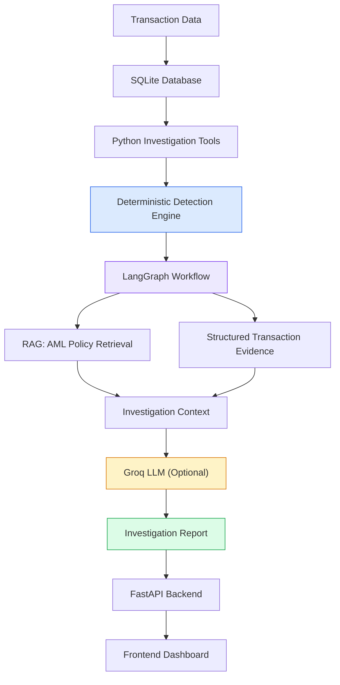

# Financial Crime Investigation AI Agent

An AI-powered financial crime investigation system built using **Python, LangGraph, FastAPI, SQLite, RAG, and Groq LLM** to identify potentially suspicious banking transactions and generate evidence-based investigation reports.

## Key Features

- Deterministic transaction pattern detection (structuring).
- AI agent workflow orchestration using LangGraph.
- Account, transaction, and historical alert retrieval.
- RAG-based AML policy retrieval using TF-IDF.
- Optional Groq LLM for analyst-friendly explanations.
- FastAPI backend with REST API endpoints.
- Interactive dashboard using HTML, CSS, and JavaScript.
- Automated testing using Pytest.

## Architecture



## Technology Stack

| Technology | Purpose |
|---|---|
| Python, Pandas | Data processing |
| SQLite | Database |
| LangGraph | Agent orchestration |
| Groq LLM | AI explanations |
| RAG, TF-IDF | Policy retrieval |
| FastAPI | Backend API |
| HTML, CSS, JavaScript | Frontend |
| Pytest | Testing |
| Git, GitHub | Version control |

## Project Structure

```text
financial-crime-investigation-agent/
├── agent/
├── api/
├── config/
├── data/
├── database/
├── detector/
├── evaluation/
├── frontend/
├── llm/
├── rag/
├── tests/
├── tools/
├── main.py
├── requirements.txt
├── .env.example
├── .gitignore
└── README.md
```

## Installation & Setup

### 1. Clone the repository

```bash
git clone https://github.com/arun2544/financial-crime-investigation-agent.git

cd financial-crime-investigation-agent
```

### 2. Create and activate virtual environment

```powershell
py -3.11 -m venv .venv

.\.venv\Scripts\Activate.ps1
```

### 3. Install dependencies

```bash
pip install -r requirements.txt
```

### 4. Configure environment variables

```powershell
Copy-Item .env.example .env
```

Add your Groq API key to `.env` (optional):

```env
GROQ_API_KEY=your_groq_api_key
GROQ_MODEL=llama-3.3-70b-versatile
```

Without a configured API key, the application uses its deterministic report fallback.

## Database & RAG Initialization

Initialize the SQLite database:

```bash
python -m database.seed_data
```

Build or refresh the policy retrieval index:

```bash
python -m rag.build_index
```

## Run the Application

### Backend

```bash
uvicorn api.routes:app --reload
```

API documentation: http://127.0.0.1:8000/docs

### Frontend

Open a second terminal:

```powershell
cd frontend

python -m http.server 5500
```

Dashboard: http://127.0.0.1:5500

### Command-Line Investigation

```bash
python main.py --account-id ACC-3010
```

## API Endpoints

| Method | Endpoint | Description |
|---|---|---|
| GET | `/` | API information |
| GET | `/health` | Backend health check |
| POST | `/investigate` | Investigate an account |

Example request:

```json
{
  "account_id": "ACC-3010"
}
```

## Detection Logic

The system identifies potential structuring patterns where:

- Multiple credit transactions belong to the same account.
- Each transaction is individually below the configured threshold.
- Their combined amount exceeds the threshold.
- Transactions occur within the configured rolling time window.
- The minimum transaction count requirement is satisfied.

Detection is performed using deterministic Python rules, not LLM-based decisions.

## Testing

Run the automated test suite:

```bash
python -m pytest -q
```

## Design Decisions

- Python handles transaction detection and evidence generation.
- LangGraph orchestrates the investigation workflow.
- RAG retrieves relevant AML policy context.
- The LLM only explains structured evidence; it does not decide whether transactions are suspicious.
- Human analysts remain responsible for investigation and compliance decisions.

## Future Improvements

- Sentence-transformer embeddings for semantic retrieval.
- Vector database integration.
- Additional transaction detection rules.
- Agent evaluation and reasoning-quality metrics.
- Audit logging and investigation history.
- Docker and cloud deployment.

## Disclaimer

This is an educational project using synthetic banking data. It is not a production AML monitoring system. Investigation results are decision-support material only and require qualified human review.
